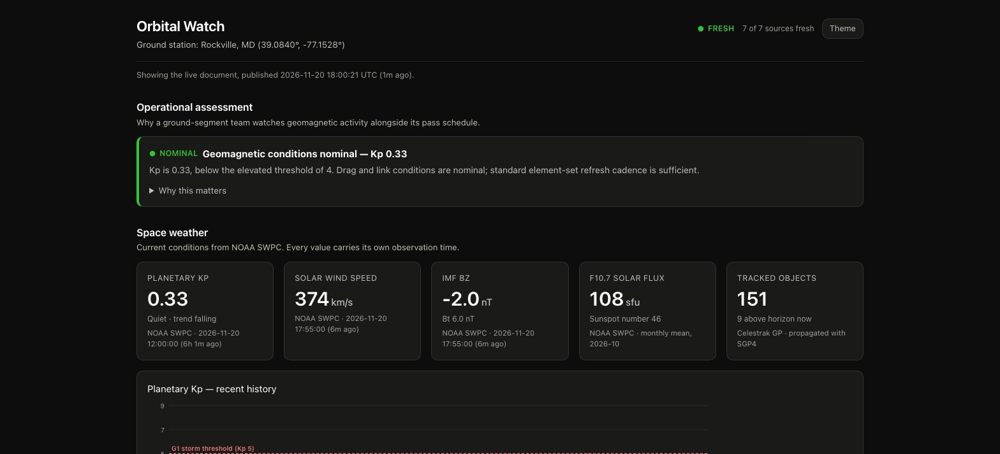
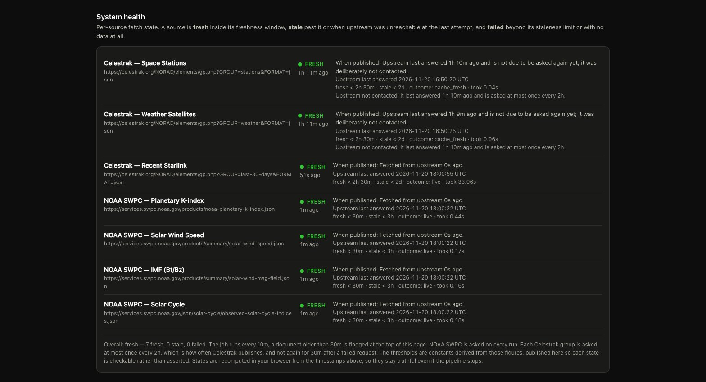
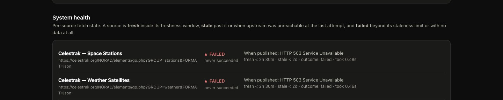

# Orbital Watch

[](https://github.com/rodrigopimenta10/orbital-watch/actions/workflows/ci.yml)

A public dashboard that tracks which satellites are passing over a ground
station and correlates those passes with live space-weather conditions.

**The design thesis: a monitoring system must report its own degradation as
honestly as it reports its data.** Every number on the page carries its source
and age; every upstream source is classified fresh, stale, or failed against
published thresholds; and no fallback — stored data, or the copy of the data
shipped with the site — is ever allowed to claim freshness it does not have.
The interesting engineering here is not the orbital mechanics, it is what
happens when things break.

**Live site:** **[orbital.rodrigopimenta.com](https://orbital.rodrigopimenta.com)**
· **[DECISIONS.md](DECISIONS.md)** — every design decision with its rationale
and the failures that forced it, which is the half of engineering a repo
usually hides. That includes the first delivery architecture, which produced
five production bugs and was replaced ([what broke](#what-broke-in-the-first-design)).



The system health panel, which is the part worth looking at closely — every
source reports its state, when upstream last answered, the thresholds that
define that state, and how long the fetch took:



And the same panel during a real degradation, three quarters of an hour
after the job first ran on Google Cloud: Celestrak was answering HTTP 503 to
everyone, the state store was still empty, and the page said exactly that. A
dashboard that only ever shows seven green rows is just asserting its own
health, not reporting it:



*All three were taken on 20 November 2026, the day of the rebuild described
below: the degraded one at 16:15 UTC, the others at 18:01 UTC. The 33-second
fetch in the second image is Celestrak on a slow day, and the reason for
[DECISIONS.md](DECISIONS.md) §33.*

---

## Why it exists

Ground-segment teams care about two things that look unrelated and are not.

The first is **when a spacecraft is reachable**. Passes over a station are
short — a low-Earth-orbit satellite is above a 10° mask for roughly five to
twelve minutes — and everything else in the schedule bends around them.

The second is **geomagnetic activity**, and it is not a curiosity. Energy
deposited into the upper atmosphere during a geomagnetic storm heats and
expands the thermosphere, raising neutral density at LEO altitudes. Higher
density means more drag: satellites lose altitude faster, along-track position
error grows between element-set updates, and published TLEs go stale sooner
than usual. The same disturbance degrades the links used to talk to those
spacecraft — HF propagation becomes unreliable at high latitudes, and
ionospheric scintillation can disrupt UHF and L-band, including GPS.

So when Kp climbs, a tracking schedule computed from yesterday's elements gets
quietly less accurate at the same moment the links get less reliable. This
dashboard puts both on one screen and states the operational consequence
explicitly rather than leaving the reader to connect them.

It is a portfolio project, not an operational tool.

---

## Architecture

```
   ┌─────────────────┐        ┌──────────────────┐
   │  Celestrak GP   │        │    NOAA SWPC     │     upstream, public,
   │  (TLE/OMM)      │        │  (Kp, wind, IMF) │     unauthenticated
   └────────┬────────┘        └────────┬─────────┘
            │ each group at most       │ every run,
            │ once per 2 h             │ conditionally
            └────────────┬─────────────┘
                         ▼
   Cloud Scheduler ──▶ Cloud Run job  ◀──▶  state bucket (private)
   every 10 min        fetch what is due     last good payload per source,
                       → propagate           and when it was last asked for
                       → evaluate health
                       → validate
                         │ one atomic write
                         ▼
                  public bucket: latest.json  ◀── Cloud Monitoring
                         │                         run failed · no run for
                         │ polled once a minute    30 min · content checks
                         ▼
                      browser  ◀── Firebase Hosting: static page, plus a
                                   copy of latest.json baked in at deploy
```

One container runs every ten minutes. It fetches whatever is due, propagates
orbits, evaluates the health of every source, and publishes **one** JSON
document. The page is static files; it reads that document and renders it.
**The browser never contacts Celestrak or NOAA, and nothing serves requests
except a CDN and a storage bucket.**

Four properties come from that shape:

1. **An upstream outage cannot take the site down.** If Celestrak is
   unreachable, the run uses the element sets it stored last time, the page
   renders every panel, and the health panel says the data is stale and why.
   Compare a live-proxy design, where the same outage puts a spinner or a
   stack trace in front of whoever is looking.
2. **State is real, so politeness is real.** What the job knows between runs
   lives in a bucket: per source, the last good payload and when upstream was
   last asked. "Ask Celestrak at most once every two hours" is enforced
   against that record, not against a schedule — so it holds if the job is
   started every ten minutes, or by hand five times in a row.
3. **A reader can never see half an update.** Everything the page shows is in
   one object, and one object write is atomic. Before the write, the document
   is validated against the shape the page reads and against the honesty
   rules below; a document that fails is withheld and the previous one stays.
4. **A stopped pipeline is visible to a visitor with no help from the
   pipeline.** The page computes every age against the reader's own clock.
   Once the document is older than three runs, it says when the pipeline last
   published. Separately, Cloud Monitoring emails the owner.

The sky view deserves a note. A low-orbit satellite crosses the sky in about
ten minutes, so positions computed when the document was written are wrong
by the time it is read. The document therefore carries a 30-minute track for
each object near the sky — its position relative to the station every 30
seconds — and the page interpolates along it to the current time. All the
orbital mechanics stays in Python; the browser draws a straight line between
two points and takes two arctangents. A test holds that straight line to
within 0.2° of SGP4. When the track runs out, the page says positions are no
longer current instead of showing old ones as live.

---

## What broke in the first design

The first version ran on Cloudflare Pages. A scheduled trigger rebuilt and
redeployed the whole site every two hours; because build containers kept
nothing between runs, a GitHub Actions cron fetched Celestrak and **committed
the result to this repository**, which was the only state the system had.

On 2026-11-20 the live site was reporting all three Celestrak sources stale:
element sets 15 hours old, against an 8-hour freshness window. Nothing had
failed.

- The Actions cron was written to run 12 times a day (`30 1-23/2 * * *`).
  GitHub ran it about 3 times a day — on 18, 19 and 20 November at 04:39,
  14:27 and 22:40; 04:25, 14:38 and 22:44; 04:11 and 14:16 UTC.
- The 04:11 run arrived 5 h 27 m after the previous capture. The politeness
  floor was 5 h 30 m, so it correctly skipped.
- The next run came ten hours later.

This was the fifth production bug, and the second with this exact cause: a
design that depended on the punctuality of a scheduler that promises none
([DECISIONS.md §19](DECISIONS.md)). The individual fix each time was correct
and the class of bug stayed, because the flaws were structural:

| Flaw | What it caused | What replaced it |
|---|---|---|
| No persistent state; "state" was commits to git | A refresh needed repository write access and a commit, and the rate-limit floor could not be enforced inside a build | A state bucket, read and written by the job |
| Refreshing data meant rebuilding and redeploying the site | A 500-builds-a-month cap dictated a 2-hour cadence for everything | The job publishes a document; the site is deployed only when code changes |
| Three schedulers on two platforms had to line up | Each could be late independently, and the freshness window was tuned against their sum | One scheduler, and an alert when its runs stop succeeding |
| Floor, cadence and window were three hand-tuned numbers | Twice, a combination where every part was right and the system was wrong | The windows are expressions over the cadence and upstream's publication interval |

---

## Reliability behaviour

This is the part worth reading closely, because it is the part the project is
actually about.

### Every upstream call goes through one function

There is exactly one place in the codebase that talks to an upstream:
`fetch_source()` in `src/orbital_watch/sources/fetch.py`. It guarantees the
same things for every caller:

- a ceiling on the whole request, body included, and a shorter limit on how
  long the connection may go silent — no unbounded waits, and a body sent at
  a trickle is abandoned instead of read for minutes;
- failure is caught, logged with source and elapsed time, and falls back to
  the last good payload in the state store;
- a source with a politeness floor is not contacted until the floor clears,
  decided from the stored record of the last attempt — which is written
  *before* the request, so it exists even if the run is stopped half way,
  and a request that cannot be recorded is not made;
- the outcome is recorded in a result object the health panel reports verbatim;
- **it never raises.** No caller can abort the run by forgetting a
  `try`/`except`, because there is nothing to catch.

A single choke point rather than scattered `try`/`except` blocks means the
question "what happens when upstream is down?" has exactly one answer, and that
answer is testable in isolation.

### What each failure actually does

| Situation | Outcome | Site behaviour | Health panel |
|---|---|---|---|
| Fetch succeeds | `live` | Fresh data | **fresh** |
| Upstream answered recently and is not due to be asked | `cache_fresh` | Stored data | **fresh** — upstream deliberately not contacted |
| Upstream says nothing changed (HTTP 304, or Celestrak's own reply) | `not_modified` | Stored data | **fresh** — and says how old the download itself is |
| Upstream down, data stored | `cache_fallback` | Stored data still renders | **stale** — with the error, even if the data is minutes old |
| Upstream down, retry not yet due | `cache_fallback` | Stored data | **stale** — still; it does not flip back to fresh between retries |
| Upstream down, nothing stored | `failed` | That panel empties, others unaffected | **failed** — with the reason |
| Data older than the staleness limit | — | Data still renders | **failed** — "not operationally current" |
| Malformed, wrong-shaped or non-JSON response, or one carrying `NaN` / `Infinity` | `cache_fallback` | Stored data | **stale** — the stored copy is *not* overwritten |
| Upstream answers, then sends the body at a trickle | `cache_fallback` | Stored data | **stale** — "gave up after 45s with the response incomplete" |
| Stored data with no date | — | Data renders | **stale** — undated is never fresh |
| State store unreadable | `failed` for Celestrak | Celestrak panels empty | **failed** — and Celestrak is *not* contacted, since nothing says when it last was |
| State store readable but not writable | `cache_fallback` for Celestrak | Stored data | **stale** — Celestrak is *not* contacted, since the request could not be recorded |
| The Kp source ages past its limit | — | The assessment banner is withdrawn | says the assessment is no longer current, and what it was |
| The document would be malformed | — | Previous document stays | unchanged; the run fails and the owner is alerted |
| The pipeline stops | — | Page shows the last document | every state recomputed in the browser; banner after 30 min |
| The page cannot reach the live document | — | Copy baked into the site is shown, labelled | nothing in it is reported **fresh** |
| The reader's clock is slow | — | Ages use the latest of the device's clock, the document's own time and the server's `Date` | no state is shown better than it was published |

Three behaviours worth calling out:

**A source can be serving good numbers and still not be "fresh."** If upstream
was unreachable at the last attempt but the stored data is ten minutes old,
the data on screen is fine — and the panel reports **stale** anyway, because
contact has been lost and saying "fresh" would be a lie. Reporting freshness
honestly is the entire purpose of the panel. The same rule is applied one
level up: when the *page* cannot reach the pipeline's live document and falls
back to the copy shipped with the site, it reports nothing in it as fresh.

**A bad response never replaces good data.** A malformed, non-JSON or
reshaped reply is rejected at the boundary, so the stored copy you would fall
back to survives. So does a reply that is valid but implausible — a
satellite group that has lost most of its members since the last fetch.

**The rules are checked on the output, not only in the code.** Before a
document is published it is validated, and the validator re-states the rules
independently: no source may be fresh on a fallback outcome or without a
date, every source must be accounted for, the overall state must be the worst
one. A future change that breaks classification cannot publish its mistake.

### What counts as a failed run

The job exits non-zero only when it **could not publish**: the bucket refused
the write, the document failed validation, or the code has a bug. An upstream
outage is not a failed run — the document says the source is down, and saying
so is the job working. That is what lets a monitoring alert on "an execution
failed" mean something instead of firing whenever NOAA has a bad hour.

Something independent watches for the rest: an alert when no run has
succeeded for 30 minutes, and uptime checks on the published document and on
the site that match content, not only a status code.

### Degradation is proven, not asserted

`tests/test_sources.py` breaks the fetch layer under four failure modes
(timeout, DNS failure, HTTP 500, HTTP 403), with and without stored data, and
feeds it damaged state in eight shapes. `tests/test_pipeline.py` breaks each
of the seven sources in turn through a whole run — on a first-ever run, and
again with stored state — then breaks all seven at once, and each time holds
the resulting document to the same validation production applies. The
blackout tests additionally assert that nothing claims to be fresh.

You can watch it happen for real:

```bash
# One run with every socket refused and nothing stored.
uv run python - <<'PY'
import socket
def dead(*a, **k): raise OSError(101, "Network is unreachable")
socket.socket.connect = dead; socket.create_connection = dead; socket.getaddrinfo = dead
from orbital_watch.job import main
raise SystemExit(main(["--local-dir", ".local-offline", "--out", "dist-offline"]))
PY
```

This exits 0, publishes a complete document, and reports 7 of 7 sources
failed. The same check runs in CI on every push, and again against the built
container with networking switched off.

---

## Local setup

Requires [uv](https://docs.astral.sh/uv/) and Python 3.11+. No cloud account
is needed: with no bucket configured, the job keeps its state and its
published document in a local directory.

```bash
git clone https://github.com/rodrigopimenta10/orbital-watch.git
cd orbital-watch

# Install dependencies (creates .venv automatically)
uv sync --dev

# Run one refresh cycle and assemble the site into dist/
uv run python -m orbital_watch.job

# Serve it -- the page fetches JSON, so file:// will not work
python3 -m http.server 8000 --directory dist
# then open http://localhost:8000
```

State lives in `.local/state/`, the published document in `.local/public/`.
Run the job again and it behaves as it does in production: space weather is
re-fetched, Celestrak is left alone until two hours have passed.

```bash
uv run python -m orbital_watch.job --verbose              # debug logging
uv run python -m orbital_watch.job --no-site              # publish only
uv run python -m orbital_watch.job --local-dir /tmp/ow    # state elsewhere
```

To see the page fall back, delete `dist/live/latest.json` (the local stand-in
for the public bucket) and reload: it shows the baked copy and says so.

Point it at a different ground station without touching code:

```bash
ORBITAL_WATCH_SITE_NAME="Svalbard" \
ORBITAL_WATCH_LAT=78.2297 \
ORBITAL_WATCH_LON=15.4075 \
  uv run python -m orbital_watch.job
```

---

## Tests

```bash
uv run pytest                 # 347 tests
uv run ruff check .           # lint
uv run ruff format --check .
node --test tests/web/*.test.js   # 53 tests of the page's logic; no npm, no dependencies
(cd infra && terraform init -backend=false && terraform test)   # 12 runs, mocked providers
```

**No test makes a network call.** That is enforced mechanically, not by
convention: an autouse fixture in `tests/conftest.py` replaces
`urllib.request.urlopen` and the socket connect call with functions that
raise, so a live call fails loudly instead of passing on one machine and
flaking in CI. Everything runs from real API responses captured into
`tests/fixtures/`.

The groups worth knowing about:

**Propagation correctness** (`test_propagate.py`) checks against the published
SGP4 verification vectors from Vallado et al., *Revisiting Spacetrack Report #3*
(AIAA 2006-6753) — an independently-known result, not a number this project
generated and then froze. Backed by physical checks that nothing in the code
knows the answer to: GOES spacecraft must come out at geostationary altitude
(~35,786 km), the ISS at a plausible LEO altitude with a ~93-minute period.
The published position track is held to SGP4 between its samples, through a
pass near the zenith.

**Health boundaries** (`test_health.py`) pin every freshness threshold
including the exact-equality cases, where off-by-one errors live.

**Graceful degradation** (`test_sources.py`, `test_pipeline.py`) is the most
important part of the suite. It proves the claim the whole architecture rests
on: that no upstream failure — individually or all at once, with stored state
or without — can prevent a run from producing a complete document that tells
the truth about its own state.

**State and concurrency** (`test_store.py`, `test_sources.py`,
`test_document.py`): the politeness floor survives a new process, a run
killed mid-request, and a store that cannot be written; two overlapping runs
ask a rate-limited source once and cannot lose each other's results; an
older run cannot replace a newer document.

**The page** (`tests/web/core.test.js`): which copy of the document is shown
and when it falls back, that a frozen pipeline is noticed from the reader's
clock alone, that a slow reader clock cannot make anything look newer than
it is, that nothing in a fallback copy is fresh, and that interpolated
positions match SGP4. The reference values for that last one are written by
the Python pipeline (`test_web_fixture.py`), so the JavaScript is checked
against SGP4 rather than against numbers typed into a test.

**Agreement across languages** (`test_repo_conventions.py`): the facts that
Python, JavaScript, Terraform and the workflows each hold a copy of — schema
version, cadence, environment variable names, the security headers — are
pinned to each other.

---

## Data sources

| Source | Endpoint | Fetched |
|---|---|---|
| [Celestrak](https://celestrak.org/) | GP API, groups `stations`, `weather`, `last-30-days` (for its Starlinks) | each group at most once every 2 h; after a failed attempt, not again for 30 min |
| [NOAA SWPC](https://www.swpc.noaa.gov/) | planetary K-index | every run (10 min), conditionally |
| NOAA SWPC | solar wind speed, IMF Bt/Bz | every run, conditionally |
| NOAA SWPC | observed solar cycle indices | every run, conditionally |

All public, unauthenticated, no API keys. **The project requires no secrets and
no `.env` file of any kind.**

"Conditionally" means the request carries the `ETag` and `Last-Modified`
upstream sent last time, so a product that has not changed costs NOAA a
header exchange (HTTP 304) and nothing more.

Celestrak rate-limits aggressively and blocks abusive clients, so:

- each group is asked **at most once per publication interval**. Celestrak
  regenerates GP data about every two hours; asking sooner cannot return
  newer element sets;
- each request has a ceiling on its whole duration (20 s; 45 s for the
  largest, under 100 KB), so a throttled download is dropped and retried
  later rather than held open;
- that floor is enforced against the stored record of the last attempt, so it
  holds however often the job runs — and if the state store cannot be read,
  Celestrak is not contacted at all;
- a failing group is retried every 30 minutes, not every run;
- requests carry a descriptive `User-Agent` identifying the project;
- only three small groups are fetched, about 1.5 MB a day in all. Never the
  full catalogue, and never the 5 MB Starlink group.

Starlink is represented by the satellites launched in the last 30 days
(sixty of about a hundred, most recent epochs), taken from Celestrak's small
`last-30-days` group — see [DECISIONS.md](DECISIONS.md) §31.

Two upstream findings, both documented in [DECISIONS.md](DECISIONS.md): the
`products/solar-wind/plasma-*.json` endpoints in the original spec now return
404 and were replaced with SWPC's summary endpoints; and Celestrak signals
"nothing has changed" with an **HTTP 403 whose body is a plain sentence**,
which needs handling on the error path or a benign no-op gets reported as a
hard failure. That sentence names the time of "your last download", which
Celestrak tracks per requesting address; it is only accepted as confirmation
if the download it names is ours (§29).

---

## Deployment

Runs on Google Cloud, in one project and one region (`us-east4`):

| Piece | Service |
|---|---|
| The refresh job | Cloud Run job `orbital-watch-refresh`, 1 vCPU / 512 MiB, a few seconds a run |
| The schedule | Cloud Scheduler, every 10 minutes |
| State | Cloud Storage bucket, private, versioned |
| The published document | Cloud Storage bucket, public read, `Cache-Control: public, max-age=60`, CORS limited to the site |
| The page | Firebase Hosting, at [orbital.rodrigopimenta.com](https://orbital.rodrigopimenta.com) |
| Alerts | Cloud Monitoring, by email |

All of it is Terraform, in [`infra/`](infra/), with the bootstrap and apply
steps, the DNS change and a cost table in [`infra/README.md`](infra/README.md).
There are no secrets in the repository and none are needed to run it: the
scheduler and the deploy workflow both authenticate with short-lived tokens,
and no service account key exists.

### Cost

About $0.50 to $1 a month at list prices — 4,320 short job runs, about 23,000
storage writes, and under a gigabyte of transfer — and most of that falls
inside free allowances. The breakdown and its assumptions are in
[`infra/README.md`](infra/README.md#cost).

### Workflows

- **`ci.yml`** — on every push and PR: `ruff` and `pytest` on Python 3.11 and
  3.12; the real entry point run with all sockets blocked, asserting a
  complete and truthful document; the page's logic under `node --test`; the
  container built and run with networking off; `terraform fmt`, `validate`
  and `test` against mocked providers. Actions are pinned to commit SHAs
  rather than tags, since a tag can be re-pointed at other code.
- **`deploy.yml`** — on pushes to `main`, signing in through Workload Identity
  Federation: build and push the image, point the job at it, start one run,
  wait until the document at the public address carries this commit's
  revision, bake that document into the site, deploy Hosting, and check what
  was published.

**Deploying does not refresh data, and data does not need a deploy.** The
schedule lives in Cloud Scheduler and nowhere else; there is no cron in this
repository, and a test fails if one is added.

### Known limits

- **Celestrak's rate limit is per address, and Cloud Run's outbound addresses
  are shared.** If another tenant on the same address fetches a group first,
  Celestrak may answer our request with "not updated since your last
  download". The job recognises that the download is not ours and reports the
  group stale rather than confirmed; if it happened persistently, the fix
  would be a reserved outbound address, which costs more than everything else
  here combined.
- **Readers can be up to about two minutes behind.** The document may be
  cached for 60 seconds and the page polls once a minute. Every age shown is
  computed from timestamps inside the document, so the lag is visible, not
  hidden.
- **The deploy account can publish to any Hosting site in the project.**
  Firebase has no narrower role. Everything else it holds is scoped to one
  resource.

---

## What is intentionally not built

Scope discipline is part of the design, so these are omissions, not gaps:

- **No user accounts, no database, no notifications to visitors.** The only
  state is a handful of objects in a bucket, and the only alerts go to the
  owner.
- **No full satellite catalogue browser.** Celestrak already is one, and doing
  it properly means search, pagination, and a much larger payload.
- **No 3D globe.** It would be the most eye-catching thing here and would tell
  an operator nothing that the elevation, azimuth, and range columns do not
  already say more precisely.
- **No mobile app.** The page is responsive; a native app would add
  distribution overhead for zero functional gain.
- **No live API proxy and nothing that serves requests.** Deliberate. The job
  runs on a schedule and writes a file; a visitor's request is answered by a
  CDN or a bucket and never causes an upstream call. A request-time backend
  would reintroduce exactly the runtime upstream dependency the architecture
  exists to remove.
- **No orbital mechanics in the browser.** The page interpolates along a
  published track. Shipping SGP4 to the client would mean a second
  implementation to keep correct, checked by nobody.
- **No illumination or eclipse modelling.** It needs a JPL ephemeris kernel —
  a ~16 MB download and another network dependency — for a feature outside
  the brief.

---

## Layout

```
src/orbital_watch/
├── config.py            observer, tracked groups, cadence, thresholds — all constants
├── store.py             storage interface: local directory or Cloud Storage bucket
├── sources/
│   ├── fetch.py         the only upstream I/O: timeout, state, politeness, outcome
│   ├── celestrak.py     GP element sets
│   └── swpc.py          space weather + Kp interpretation
├── propagate.py         SGP4 → position tracks and passes
├── health.py            freshness state machine
├── pipeline.py          one cycle: fetch, propagate, evaluate, assemble the document
├── document.py          the document's shape, its validation, and publication
├── job.py               entry point of the scheduled job
└── site.py              assembles the static site around a baked copy of the document
web/                     static frontend, copied into the site as it is
  assets/config.js       where the document is; the one file a deploy rewrites
  assets/core.js         the page's logic, no DOM (tested under Node)
  assets/app.js          the drawing
infra/                   Terraform: job, schedule, buckets, monitoring, deploy identity
tests/                   pytest; tests/web/ for the page; tests/fixtures/ real API responses
Dockerfile               the job's image
firebase.json            Hosting: response headers (CSP, caching)
```

Design decisions and their rationale are in [DECISIONS.md](DECISIONS.md).
